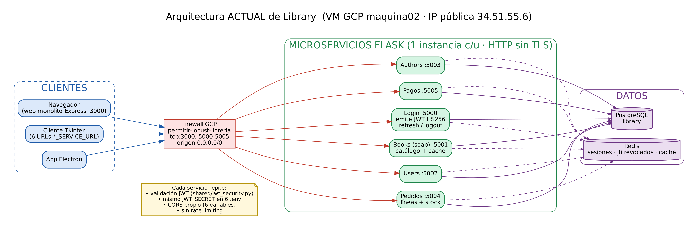
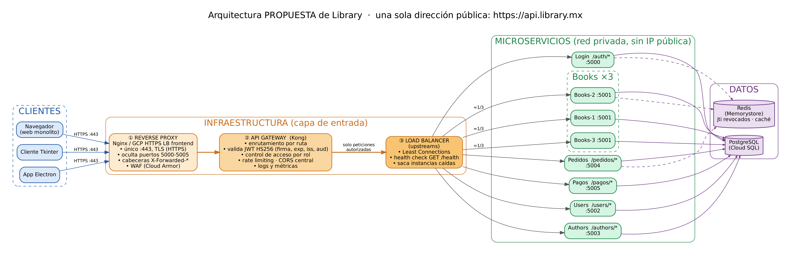
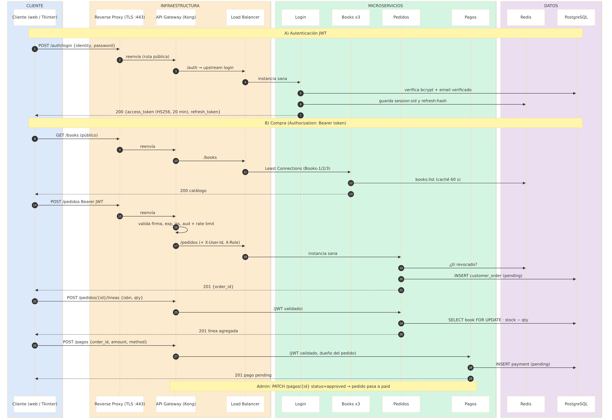

**Integrantes:** Mauricio Gallardo Barbosa (588218) · Luz Colunga (593350) · Carlos Rodrigo Gómez González (652303)

_Damos nuestra palabra que hemos hecho esta actividad con integridad académica._

**Animación del flujo JWT + compra (Ubiquitous):** https://ubiquitous.udem.edu/~iac-652303/library-jwt-compra/ (código fuente en `library-jwt-compra/index.html`)

# 1. Investigación de tecnologías

## 1.1 Proxy y Reverse Proxy

Un **proxy (forward proxy)** representa al **cliente**: los equipos de una red salen a Internet a través de él, que filtra, cachea u oculta la IP del cliente (ej. proxy corporativo o escolar). Un **reverse proxy** representa al **servidor**: recibe las peticiones de Internet y las reenvía a servidores internos, que nunca quedan expuestos.

| | Forward proxy | Reverse proxy |
|---|---|---|
| A quién protege | Al cliente | Al servidor / servicios |
| Quién lo configura | El cliente o su red | El dueño del sistema |
| Usos | Filtrado, anonimato, caché de salida | TLS/HTTPS, ocultar puertos, caché, compresión, WAF |

**Ventajas:** un solo punto público, terminación TLS, oculta la topología interna, caché y compresión. **Limitaciones:** es un salto extra (latencia), punto único de falla si hay una sola instancia, no entiende reglas de negocio.

Ejemplo con Nginx (una sola dirección para Library):

```nginx
server {
  listen 443 ssl;
  server_name api.library.mx;
  location /auth/    { proxy_pass http://127.0.0.1:5000/; }
  location /books/   { proxy_pass http://books_upstream/; }
  location /pedidos/ { proxy_pass http://127.0.0.1:5004/pedidos/; }
  proxy_set_header X-Forwarded-For $proxy_add_x_forwarded_for;
}
```

## 1.2 Load Balancer

Distribuye el tráfico entre **varias instancias del mismo servicio** para lograr alta disponibilidad y escalabilidad horizontal (agregar instancias en vez de una máquina más grande).

- **Round Robin:** turnos (1→2→3→1…). Simple; ideal si las peticiones cuestan lo mismo. Es el predeterminado de Nginx.
- **Least Connections:** envía a la instancia con menos conexiones activas; mejor cuando hay peticiones lentas y rápidas mezcladas (`least_conn` en Nginx).
- **Health checks:** pasivos (Nginx open source marca un servidor caído tras `max_fails` fallas en `fail_timeout`) o activos (consultan periódicamente `GET /health`; HAProxy, Traefik, Kong, GCP y NGINX Plus).
- **Alta disponibilidad:** si una instancia falla, el balanceador la saca de la rotación y el cliente no lo nota.

```nginx
upstream books_upstream {
  least_conn;
  server 10.0.0.11:5001 max_fails=3 fail_timeout=30s;
  server 10.0.0.12:5001 max_fails=3 fail_timeout=30s;
  server 10.0.0.13:5001 max_fails=3 fail_timeout=30s;
}
```

**Limitación:** si el servicio guarda estado en memoria se requieren sesiones "pegajosas"; en Library no aplica porque el estado vive en PostgreSQL y Redis.

## 1.3 API Gateway

Punto único de entrada **para APIs** que entiende la petición a nivel de aplicación:

- **Enrutamiento:** `/auth/*` → Login, `/books/*` → Books, `/pedidos/*` → Pedidos, etc.
- **Autenticación JWT:** valida firma, expiración (`exp`), emisor (`iss`) y audiencia (`aud`) antes de que la petición llegue al servicio.
- **Control de acceso:** reglas por ruta y rol (ej. `DELETE /pedidos/{id}` solo `admin`).
- **Rate limiting:** limita peticiones por usuario/IP (ej. 5 intentos de login por minuto) contra fuerza bruta y abuso.
- **CORS centralizado:** una sola política de orígenes en lugar de una por servicio.
- **Monitoreo:** logs, métricas (latencia, códigos 4xx/5xx) y trazas por ruta.

**Limitaciones:** otro componente que operar y asegurar; si se mete lógica de negocio se vuelve un monolito; también es punto único de falla si no se replica.

**Diferencia clave:** el reverse proxy *reenvía* tráfico, el load balancer *reparte* tráfico entre réplicas, y el API Gateway *decide* si una petición de API puede pasar y a dónde. Una herramienta puede cumplir varias funciones, pero son roles distintos.

## 1.4 Comparación de herramientas

| Herramienta | Reverse proxy | Load balancer | API Gateway | Notas |
|---|---|---|---|---|
| **Nginx** | Sí (fuerte) | Sí: RR, least_conn, ip_hash; health checks pasivos | Parcial (con módulos/config) | Servidor web + TLS; muy conocido |
| **HAProxy** | Sí | Sí (muy fuerte): muchos algoritmos, health checks activos, L4/L7 | No nativo | Alto rendimiento y alta disponibilidad |
| **Traefik** | Sí | Sí, health checks | Parcial (middlewares: rate limit, auth) | Autodescubre servicios en Docker/Kubernetes |
| **Kong** | Sí (basado en Nginx) | Sí (upstreams + health checks) | **Sí, completo**: plugins JWT, rate-limiting, CORS, ACL, métricas | Soporta JWT HS256 como el de Library |
| **Google Cloud Load Balancing** | Sí (administrado) | Sí: global, autoescalado, health checks | No (se combina con API Gateway/Apigee) | Certificados TLS administrados, Cloud Armor (WAF) |

# 2. Aplicación al proyecto Library

## 2.1 Arquitectura actual (verificada en nuestro código)

Revisamos la carpeta `library/` de nuestro repositorio. Los puertos reales de nuestra implementación son **Login 5000, Books 5001 (`apps/services/soap`), Users 5002, Authors 5003, Pedidos 5004 y Pagos 5005** (el enunciado lista otra numeración; usamos la real). El monolito Express corre en el 3000 y actúa como proxy guardando el JWT en la sesión.



Hallazgos del código:

- Todo corre en **una VM de GCP (maquina02)**; la regla `permitir-locust-libreria` abre `tcp:3000,5000-5005` a `0.0.0.0/0`.
- **Seis servicios Flask, una instancia cada uno, HTTP sin TLS.**
- Login emite JWT **HS256** (`iss=library-login`, `aud=library-book`, 20 min) con refresh token de un solo uso; la revocación por `jti` y las sesiones viven en **Redis**.
- **Cada servicio valida el JWT por su cuenta** (`shared/jwt_security.py`, decorador `require_bearer`), y el **mismo `JWT_SECRET` se copia en seis `.env`**.
- **CORS se configura seis veces** (`LOGIN_CORS_ORIGINS`, `BOOKS_CORS_ORIGINS`, …). No hay rate limiting.
- Los servicios **no se llaman entre sí por HTTP**: comparten PostgreSQL. Pedidos descuenta stock en la tabla `book` con `SELECT … FOR UPDATE`, y Pagos marca el pedido como `paid`.

## 2.2 Respuestas a las preguntas

**¿Qué problemas presenta exponer múltiples microservicios mediante puertos diferentes?**
1. Superficie de ataque: siete puertos abiertos a todo Internet, sin HTTPS, así que el JWT viaja en texto plano.
2. Acoplamiento del cliente: Tkinter guarda seis URLs (`*_SERVICE_URL`); si un servicio cambia de puerto o IP hay que actualizar todos los clientes.
3. Seguridad duplicada: validación JWT, CORS y secreto repetidos en seis lugares. Basta un error en uno para abrir un hueco.
4. Sin protección contra abuso: no hay rate limiting en `/login`.
5. Sin alta disponibilidad: una instancia por servicio en una sola VM (punto único de falla) y no se puede escalar Books.
6. Sin vista central de logs o métricas.

**¿Cómo accederían los clientes mediante una sola dirección pública?**
Con un dominio `https://api.library.mx` en el puerto 443. El reverse proxy termina TLS y el API Gateway enruta por prefijo: `/auth`, `/books`, `/users`, `/authors`, `/pedidos`, `/pagos`. El firewall solo deja pasar el 443; los puertos 5000-5005 quedan en red privada. Tkinter y Electron configuran una sola `BASE_URL`.

**¿Dónde implementarían la validación JWT, el balanceo, el enrutamiento y la seguridad?**

| Función | Dónde | Por qué |
|---|---|---|
| TLS, ocultar puertos, WAF | Reverse proxy (borde) | Es lo primero que toca Internet |
| Validación JWT (firma, exp, iss, aud), roles, rate limiting, CORS, enrutamiento | API Gateway (Kong) | Un solo lugar, un solo secreto; rechaza antes de gastar recursos del servicio |
| Balanceo y health checks | Load balancer (upstreams) | Reparte entre réplicas y retira las caídas |
| Revocación por `jti` y reglas de negocio ("dueño del pedido") | Microservicio (se conserva `require_bearer`) | Defensa en profundidad: el gateway no conoce los datos del pedido |

**¿Cómo distribuirían las solicitudes con tres instancias de Books?**
Con un upstream `books` de tres instancias (Books-1/2/3) en **Least Connections**: las búsquedas `/books/search` tardan más que `/books/{isbn}`, así que repartir por carga real funciona mejor que Round Robin. Cada instancia expone `GET /health` (ya existe y revisa PostgreSQL y Redis). Si una falla, sale de la rotación. Como la caché `books:*` está en Redis compartido, las tres instancias ven los mismos datos y no hacen falta sesiones pegajosas.

**¿Qué pasaría si Pedidos dejara de funcionar?**
- *Hoy:* el cliente recibe "connection refused" o un timeout en el puerto 5004 y no puede crear pedidos ni líneas. Books, Login, Users y Authors siguen funcionando, y Pagos también, porque lee el pedido directamente de PostgreSQL. No queda stock "a medias" gracias a las transacciones.
- *Con la propuesta:* el health check detecta la falla y el balanceador deja de enviarle tráfico. Si hay otra réplica, el usuario no lo nota. Si no hay ninguna, el gateway responde rápido un `503` en JSON en lugar de dejar colgado al cliente, y el grupo de instancias administrado de GCP recrea la VM (autohealing). El resto del sistema sigue operando: fallo aislado.

**¿Qué solución recomendarían para desplegar Library en GCP y por qué?**
1. **External Application Load Balancer de GCP** como reverse proxy y balanceador de borde: IP única, certificado HTTPS administrado y **Cloud Armor** (WAF y límites por IP).
2. **Kong** como API Gateway (en GKE Autopilot o en un grupo de instancias). Su plugin JWT soporta **HS256**, el algoritmo que ya usa Login. GCP API Gateway espera claves públicas (JWKS), lo que obligaría a migrar a RS256, y Apigee es excesivo para el tamaño del proyecto.
3. **Microservicios en grupos de instancias administrados o GKE** con health checks, autohealing y autoescalado (Books con mínimo 3 réplicas), en red privada.
4. **Cloud SQL (PostgreSQL)** y **Memorystore (Redis)** administrados.

*Alternativa económica para el curso:* en la VM actual, Nginx (443) + Kong en Docker y cerrar la regla de firewall de los puertos 5000-5005.

## 2.3 Arquitectura propuesta



Recorrido: **Cliente → ① Reverse Proxy (HTTPS 443) → ② API Gateway (JWT, rol, rate limit, CORS, ruta) → ③ Load Balancer (instancia sana, least connections) → Microservicio → PostgreSQL / Redis.**

## 2.4 Flujo de autenticación JWT y compra (Login, Books, Pedidos, Pagos)



1. `POST /auth/login` → Login verifica bcrypt y correo verificado, guarda la sesión en Redis y devuelve `access_token` (20 min) + `refresh_token`.
2. `GET /books` (público) → el balanceador elige Books-1/2/3; responde desde la caché de Redis.
3. `POST /pedidos` con `Authorization: Bearer` → el gateway valida el token, Pedidos revisa la revocación del `jti` y crea el pedido `pending`.
4. `POST /pedidos/{id}/lineas` → descuenta stock en una transacción.
5. `POST /pagos` → pago `pending`; un admin lo aprueba (`PATCH /pagos/{id}`) y el pedido pasa a `paid`.

Animación en Ubiquitous: https://ubiquitous.udem.edu/~iac-652303/library-jwt-compra/

## 2.5 Beneficios, limitaciones y justificación

**Beneficios:** una sola URL y un solo puerto; HTTPS; secreto JWT en menos lugares; CORS y rate limiting centralizados; escalado horizontal de Books; tolerancia a fallas con health checks; logs y métricas en un solo punto.

**Limitaciones:** más componentes que configurar y vigilar; un salto extra de latencia (milisegundos); el gateway y el balanceador deben replicarse para no convertirse en un nuevo punto único de falla; mayor costo en GCP; la base de datos compartida sigue acoplando Pedidos, Pagos y Books.

**Justificación:** elegimos componentes que encajan con lo que ya existe. Los `/health` sirven para los health checks, Redis compartido permite instancias sin estado, y HS256 encaja con Kong. Así la evolución no requiere reescribir los servicios.

# 3. Reflexión del equipo

- **Diferencias:** el reverse proxy oculta y protege los servidores (TLS, un punto de entrada); el load balancer reparte carga entre réplicas y retira las caídas; el API Gateway aplica reglas de API (JWT, roles, límites, CORS, rutas). Pueden vivir en la misma herramienta, pero resuelven problemas distintos.
- **Más necesaria hoy en Library:** el **API Gateway**, porque hoy repetimos JWT, CORS y secreto en seis servicios y tenemos siete puertos públicos. Centralizarlo da el mayor salto en seguridad.
- **Mejoras:** *seguridad*: solo el 443, HTTPS, rate limit y WAF; *disponibilidad*: réplicas, health checks y autohealing; *escalabilidad*: más instancias de Books sin tocar a los clientes.
- **IA utilizada:** Claude (Anthropic) para investigar, comparar herramientas y generar diagramas. Lo verificamos contra la documentación oficial (Nginx, Kong, Google Cloud) y contra **nuestro código**: puertos, claims del JWT, uso de Redis, regla de firewall y transacciones de stock salen de los archivos del repositorio.
- **Aprendizaje:** separar responsabilidades de infraestructura (entrada, seguridad, balanceo) de la lógica de los servicios, y diseñar servicios sin estado con `/health` desde el inicio.

# 4. Referencias

- NGINX. *Using nginx as HTTP load balancer.* https://nginx.org/en/docs/http/load_balancing.html
- NGINX. *ngx_http_upstream_module.* https://nginx.org/en/docs/http/ngx_http_upstream_module.html
- HAProxy Technologies. *HAProxy Configuration Manual.* https://docs.haproxy.org/
- Traefik Labs. *Traefik Proxy Documentation.* https://doc.traefik.io/traefik/
- Kong Inc. *JWT, Rate Limiting y CORS plugins.* https://developer.konghq.com/plugins/
- Google Cloud. *Cloud Load Balancing overview.* https://cloud.google.com/load-balancing/docs/load-balancing-overview
- Google Cloud. *API Gateway overview* y *Apigee.* https://cloud.google.com/api-gateway/docs
- Google Cloud Architecture Center. *Gated egress and gated ingress.* https://docs.cloud.google.com/architecture/hybrid-multicloud-secure-networking-patterns/gated-egress-ingress
- Código del proyecto Library: `apps/services/*`, `shared/jwt_security.py`, `scripts_vm/firewall_gcp.cmd`, `README.md`.
